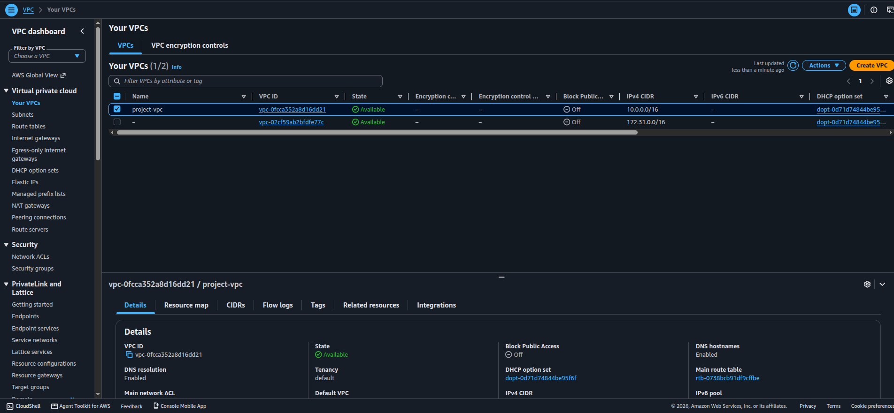
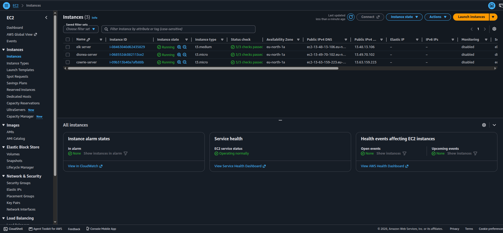
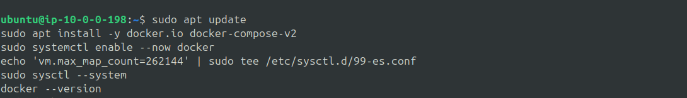
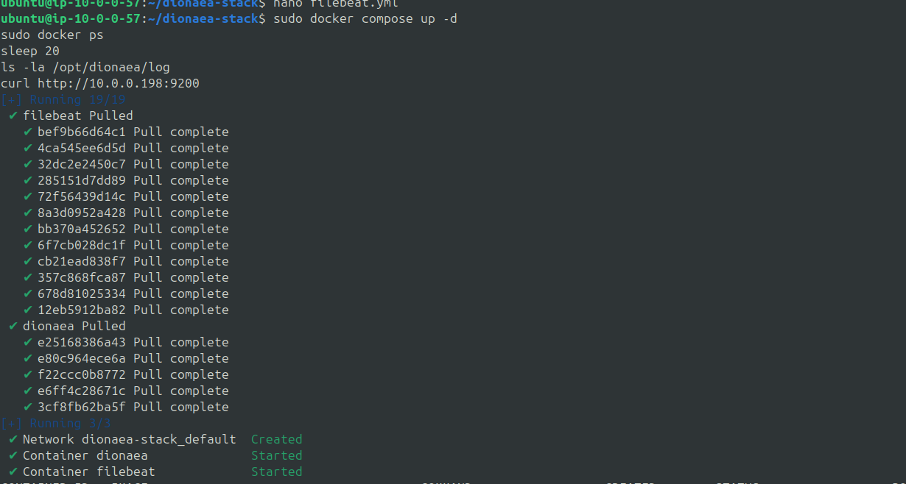
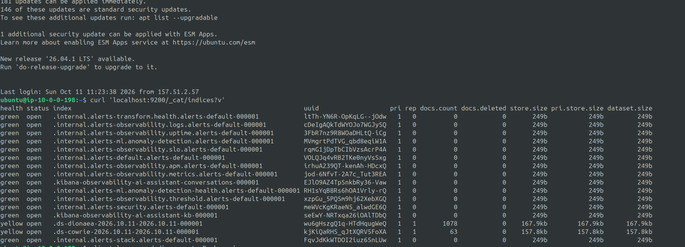
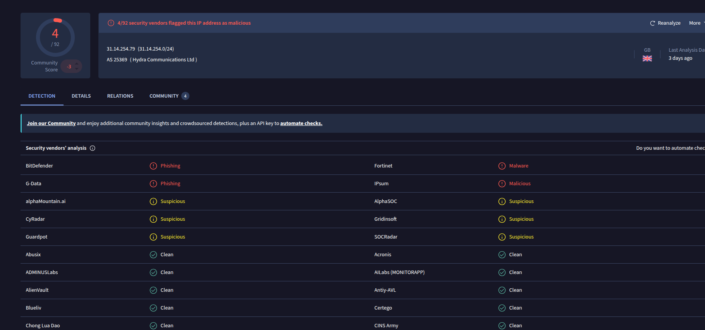
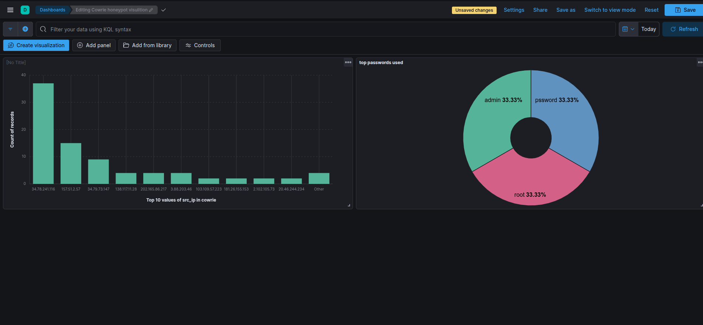
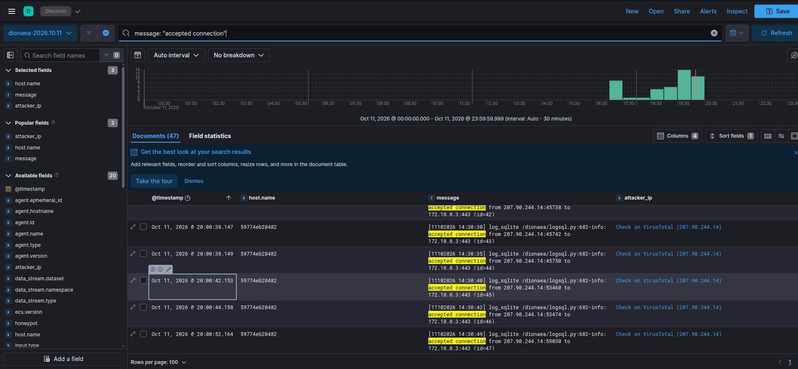

# Multi-Honeypot Deployment with Centralized ELK Logging on AWS

A lab-scale honeypot cluster on AWS. Two honeypots (Cowrie and Dionaea) ship their logs through Filebeat to a separate ELK server, where I searched and visualized the activity in Kibana.

> **Scope note:** this is a learning lab, not a production system. See [What I'd change for production](#what-id-change-for-production).

---

## Goal

Practice the core SOC workflow end to end: collect logs from more than one source, centralize them, and investigate them. The cluster layout (honeypots separate from the logging server) was suggested by an interviewer, so I built it.

## Architecture

```
                    Internet
                       |
          +------------+------------+
          |                         |
   [ Cowrie instance ]      [ Dionaea instance ]
   SSH/Telnet honeypot      FTP, HTTP/S, SMB, MSSQL, MySQL
   Docker: cowrie           Docker: dionaea
   Docker: filebeat         Docker: filebeat
          |                         |
          +------------+------------+
                       | private IPs, port 9200
                       v
                [ ELK instance ]
                Elasticsearch + Kibana (Docker)
                       |
                       v
              Kibana dashboards (my IP only)
```

| Instance | Type | Runs |
|---|---|---|
| `cowrie-server` | t3.micro | Cowrie + Filebeat (Docker) |
| `dionaea-server` | t3.micro | Dionaea + Filebeat (Docker) |
| `elk-server` | t3.medium | Elasticsearch + Kibana (Docker) |

- **Region:** eu-north-1 (Stockholm), one Availability Zone
- **Network:** custom VPC `10.0.0.0/16`, one public subnet `10.0.0.0/24`, internet gateway, no NAT gateway
- **OS:** Ubuntu Server 24.04 LTS on all three




## Security groups

| Group | Inbound |
|---|---|
| ELK | 9200 from the Cowrie and Dionaea groups only; 5601 (Kibana) and 22 (SSH) from my IP only |
| Cowrie | 22 and 23 from anywhere (honeypot bait); 2222 (real SSH) from my IP only |
| Dionaea | 21, 80, 443, 445, 1433, 3306 from anywhere (honeypot bait); 22 (real SSH) from my IP only |

## Build steps

### 1. ELK server
Installed Docker, set `vm.max_map_count=262144`, and started Elasticsearch and Kibana from one compose file. Elasticsearch runs single-node with a 1 GB heap to fit the 4 GB instance.



### 2. Cowrie
Cowrie needs port 22 as bait, so I moved the real SSH service to port 2222 first.

After the change, `ss -tlnp` showed **both** 22 and 2222 listening. The old SSH process was still holding port 22 and would have blocked Docker's `22:2222` port mapping. I tested port 2222 in a second terminal before closing my first session, then rebooted to clear the old listener.


Cowrie runs in Docker with host port 22 mapped to container port 2222, and its JSON log folder is mounted on the host so Filebeat can read it.

### 3. Dionaea
Dionaea runs in Docker with its service ports mapped. I opened six of them in the security group (21, 80, 443, 445, 1433, 3306). Its log is plain text, so Filebeat ships it to its own `dionaea-*` index.



### 4. Verifying the pipeline
Before trusting anything, I logged into Cowrie myself with a throwaway password and confirmed the event appeared in Kibana. I also checked the Elasticsearch indices for both honeypots.



### 5. VirusTotal lookup
Dionaea's log is plain text, so there is no IP field to click. In the `dionaea-*` Kibana data view I added a **runtime field** called `attacker_ip`. A short Painless script reads the raw `message` and extracts the IP after `accepted connection from`. The field uses the URL format with a VirusTotal template, so each attacker IP is a one-click link to that IP's VirusTotal page.

The script is in [`kibana/dionaea-attacker-ip.painless`](kibana/dionaea-attacker-ip.painless). It runs at query time in Kibana. Filebeat and Elasticsearch don't store the IP as a separate field. This is a manual lookup link, not automated enrichment.

I wrote the first version with an AI assistant's help. It read `message.keyword`, which failed because Elasticsearch drops keyword values longer than 256 characters (`ignore_above`), so long Dionaea lines had no `message.keyword` at all. Reading `params._source.message` instead fixed it.

## Results

The honeypots were exposed for a few hours on one day, so this is a snapshot, not a trend.

| Index | Documents |
|---|---|
| `cowrie-*` | 63 |
| `dionaea-*` | 1,078 |

- **Cowrie:** the top external source IP was `34.78.241.116` with 37 events, followed by `34.79.73.147` with 9. Several other external IPs appeared with a few events each.
- **Dionaea:** filtering the log for `accepted connection` returned 47 events, with repeated connections to port 443 visible, for example from `207.90.244.14`.
- **VirusTotal:** I looked up `31.14.254.79`, an external IP that connected to the `[Cowrie / Dionaea]` honeypot. VirusTotal showed 4 of 92 vendors flagging it as malicious (BitDefender and G-Data as phishing, Fortinet as malware, IPsum as malicious), six more marking it suspicious, and a community score of -3. It belongs to AS25369 (Hydra Communications Ltd, GB). These verdicts describe the IP's general reputation. They don't prove what that IP did to my honeypot.






### Reading the numbers honestly
- **One IP in the Cowrie chart is mine.** It is my own test traffic (my home connection, hidden in the screenshot) and is not counted as an attack.
- **Documents are not attacks.** One Cowrie session produces several events (connect, login, command, close). Dionaea's 1,078 documents include startup and internal log lines. The 47 `accepted connection` events are the closest measure of inbound connections.
- **The password chart is too small to conclude anything.** It showed three values, and one of them (`pssword`) is my own test password.
- **I haven't researched who owns these IPs.** I'm not claiming a country or provider for any of them.

## What I'd change for production

- Turn on Elasticsearch security and TLS (currently off, with plain HTTP everywhere)
- Put ELK in a private subnet and reach it through SSM or a VPN, instead of giving it a public IP
- Restrict honeypot outbound traffic so a compromised honeypot can't be used to attack others
- Pin container image versions instead of `latest`
- Add retention (index lifecycle) and snapshots, and don't run a single node
- Parse Dionaea's text log at ingest time (Filebeat processor or Elasticsearch ingest pipeline) instead of extracting the IP at query time with a Kibana runtime field
- Add detection rules and alerting on top of the dashboards
- Build the whole thing with Terraform instead of by hand
- Keep Dionaea's captured malware samples in a locked-down folder, not a world-writable one

## What I learned

- Host and container port conflicts: a service already on port 22 silently breaks a container's port mapping
- Verify a log pipeline at every hop (log file, Filebeat, index, data view) before trusting a dashboard
- Raw event counts overstate activity, so filtering matters before you draw conclusions
- Elasticsearch's default 256-character limit on keyword sub-fields can silently remove a field from long log lines
- Cost control on AWS: stop or delete instances when idle, and set budget alerts
- Copy hand-edited configs off an instance before terminating it

## Repo contents

```
.
├── README.md
├── elk/docker-compose.yml
├── cowrie/docker-compose.yml
├── cowrie/filebeat.yml
├── dionaea/docker-compose.yml
├── dionaea/filebeat.yml
├── kibana/dionaea-attacker-ip.painless
├── dashboards/export.ndjson
└── screenshots/
```

## Cleanup

After capturing evidence, I terminated all instances and volumes, deleted the security groups, and deleted the VPC so nothing keeps charging.

## Author

Vishwajith D | [LinkedIn](https://linkedin.com/in/vishwajith-d-50a196291) | [GitHub](https://github.com/vishwasec345)
